<div align="center">

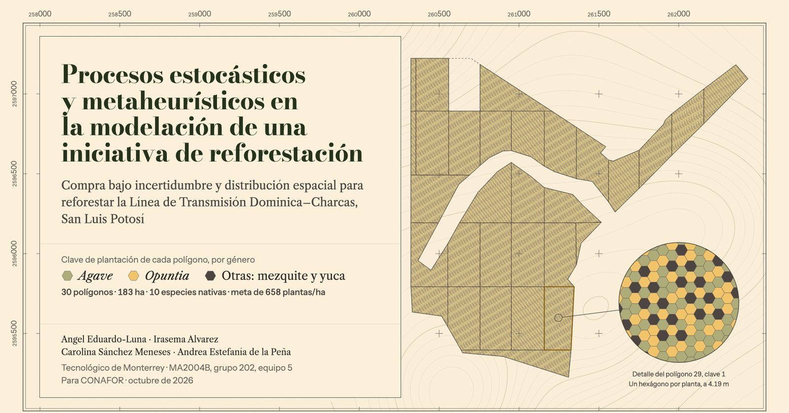

# `refor`

### Compra bajo incertidumbre y distribución espacial para reforestar la<br>Línea de Transmisión Dominica–Charcas, San Luis Potosí

**Cuántas plantas de cada especie comprar** para cumplir la meta con probabilidad de al menos 1 − α al menor costo,
y **cómo acomodarlas en el terreno** para que las vecinas compitan lo menos posible.


[El resultado](#-el-resultado) ·
[El problema](#-el-problema) ·
[Cómo funciona](#-cómo-funciona) ·
[Modelos](#-nivel-1-cuánto-comprar) ·
[Resultados](#-resultados) ·
[Herramientas](#-herramientas) ·
[Descargar](#-descargar) ·
[Compilar](#-instalación-y-uso) ·
[Arquitectura](#-arquitectura)

</div>

---

## ◆ El resultado

<table>
<tr>
<td align="center" width="25%"><h2>$14,496</h2>por hectárea es el presupuesto mínimo para cumplir la meta con 95 % de probabilidad. Hay $12,500.</td>
<td align="center" width="25%"><h2>108,680</h2>plantas a comprar para los 30 polígonos: 594/ha que, con las 129/ha existentes, dan 723/ha.</td>
<td align="center" width="25%"><h2>−16 %</h2>de competencia entre plantas vecinas frente a sembrar al azar, con solo 6 claves de plantación.</td>
<td align="center" width="25%"><h2>≤ 4.5 %</h2>es la distancia máxima del memético al óptimo, probada con un modelo entero (HiGHS).</td>
</tr>
</table>

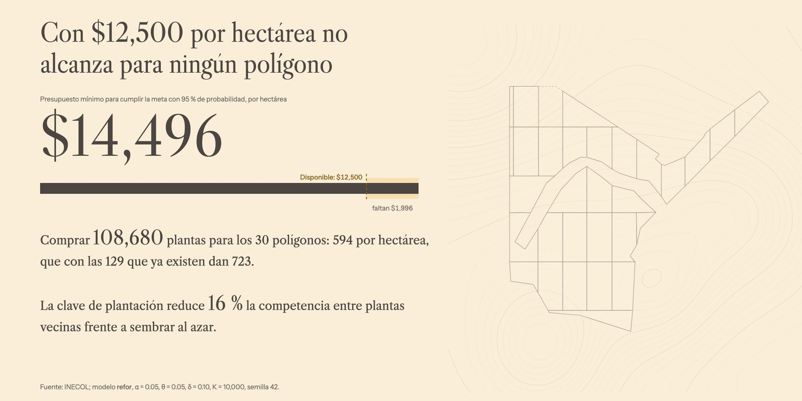

> **Con \$12,500 por hectárea ningún polígono es factible.** La brecha es estructural: aceptar 50 veces más riesgo
> (α de 1 % a 50 %) solo baja el presupuesto mínimo 3.7 %. Lo que excede el presupuesto es el déficit de plantas mismo,
> no el margen de seguridad. El modelo dice cuánto falta y cuánto comprar en cuanto se ajuste el presupuesto o la meta.

<sub>Todas las cifras salen de `data/processed/` y de la salida de `refor` (α = 0.05, θ = 0.05, δ = 0.10, K = 10,000, semilla 42). Ninguna es ilustrativa.</sub>

---

## ◆ El problema

CONAFOR va a reforestar **30 polígonos (183.01 ha, de 1.28 a 8 ha cada uno)** a lo largo de la Línea de Transmisión
Dominica–Charcas, en matorral desértico rosetófilo y micrófilo deteriorado por el sobrepastoreo. El plan de INECOL pide
**658 plantas por hectárea** de **10 especies nativas** —cuatro agaves, cuatro nopales, mezquite y yuca— al tresbolillo.

<table>
<tr>
<td width="55%">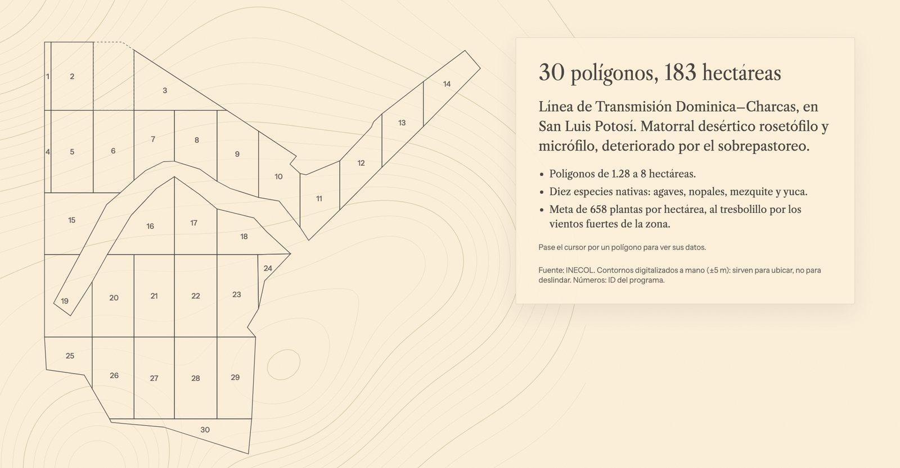</td>
<td width="45%">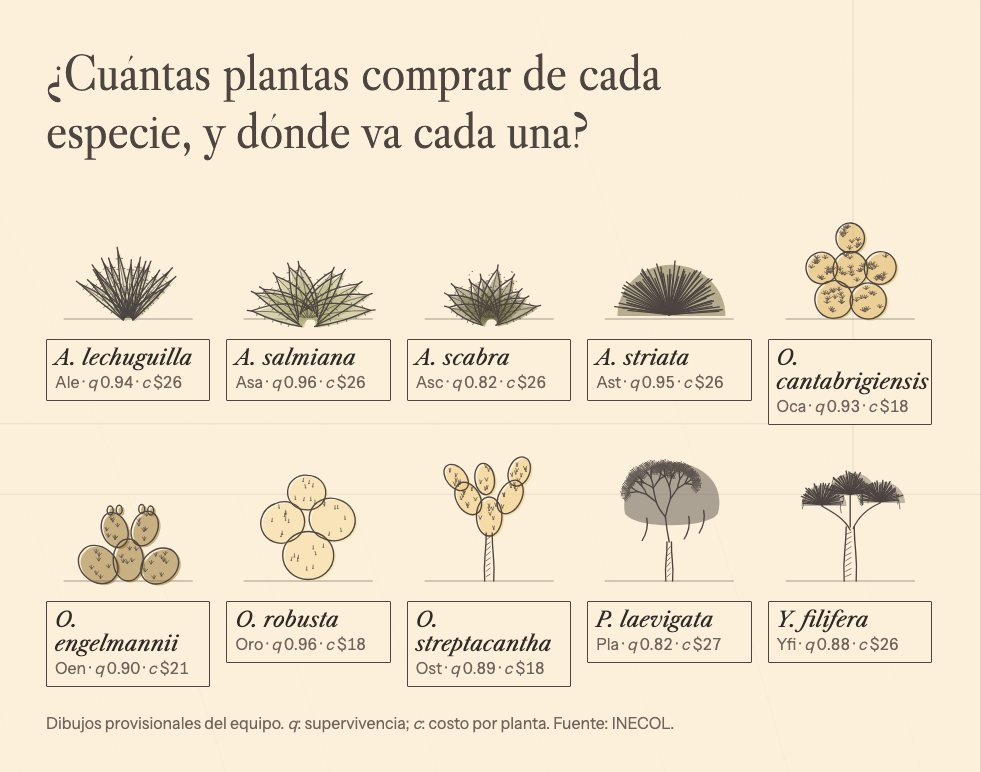</td>
</tr>
<tr>
<td><sub>Los 30 polígonos, digitalizados a mano (±5 m) desde la cartografía de INECOL.</sub></td>
<td><sub>Las 10 especies, con su supervivencia al primer año <i>q</i> y su costo por planta <i>c</i>.</sub></td>
</tr>
</table>

Hay que tomar **dos decisiones**, y ninguna se puede tomar con certeza:

| | Decisión | Lo que no sabemos de antemano |
|---|---|---|
| **1** | **Cuánto comprar** de cada especie en cada polígono | Cuántas plantas nuevas sobreviven (de 82 % a 96 % según la especie) y cuántas ya existen en el sitio |
| **2** | **Dónde va cada planta** dentro del polígono | Qué tanto compite cada pareja de especies por luz, agua y raíz |

Hoy la compra se decide a ojo y la siembra sigue un orden fijo. `refor` las sustituye por decisiones con respaldo
probabilístico y de optimización, y **muestra la brecha al óptimo en lugar de ocultarla**.

---

## ◆ Cómo funciona

El problema se separa en dos niveles: la compra (estocástica) alimenta a la distribución espacial (combinatoria).

```mermaid
flowchart LR
    A["Excel de INECOL<br/>data/raw"] --> B["CSV<br/>data/processed"]
    B --> C["Monte Carlo<br/>K = 10,000 escenarios<br/>curvas x*(n) y E[D](n)"]
    C --> D["Mochila de elección múltiple<br/>DP exacta + HiGHS"]
    D --> E(["Compra por<br/>polígono y especie"])
    E --> F["Composición del mosaico<br/>52 posiciones, mayor residuo"]
    F --> G["Memético + búsqueda tabú<br/>30 corridas en paralelo"]
    G --> H(["Clave de plantación"])
    G -. arranque en caliente .-> I["Modelo entero<br/>HiGHS"]
    I -. cota inferior y brecha .-> H

    classDef dato fill:#FCF0DA,stroke:#4C4541,color:#2E2A27
    classDef compra fill:#F2C46A,stroke:#8C6418,color:#2E2A27
    classDef espacial fill:#AEAC78,stroke:#6F6D43,color:#2E2A27
    classDef salida fill:#4C4541,stroke:#2E2A27,color:#FCF0DA
    class A,B dato
    class C,D compra
    class F,G,I espacial
    class E,H salida
```

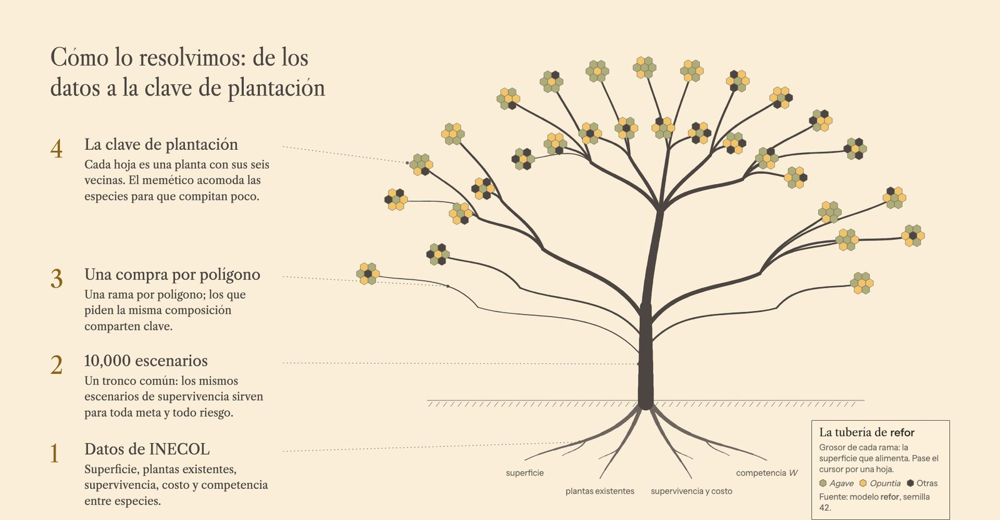

---

## ◆ Nivel 1: cuánto comprar

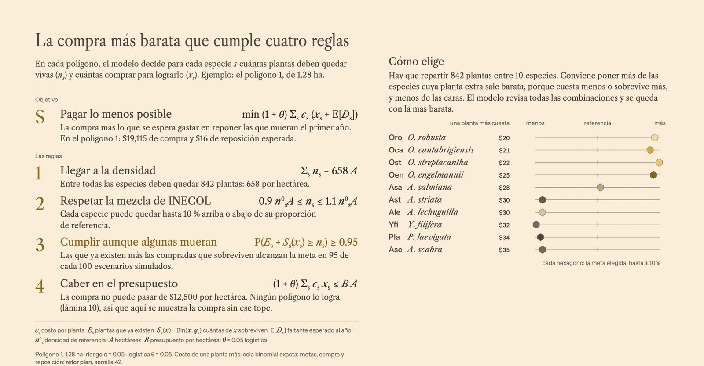

Para cada polígono $i$ se elige una **meta** $n_{is}$ y una **compra** $x_{is}$ por especie $s$. Las plantas existentes
$E_{is}$ son los conteos observados por INECOL y los sobrevivientes de lo plantado son $S_{is}(x)\sim\mathrm{Bin}(x,q_s)$:

$$
\begin{aligned}
\min_{n,\,x}\quad & (1+\theta)\sum_{s}c_s\,x_{is} \;+\; \sum_{s}c_s^{R}\,\mathbb{E}\big[D_{is}\big] && \text{compra + reposición esperada}\\
\text{s.a.}\quad & \textstyle\sum_{s} n_{is} = 658\,A_i && \text{densidad total}\\
& \lvert n_{is}-n_s^0A_i\rvert \le \delta\, n_s^0A_i && \text{mezcla de INECOL } (\pm 10\,\%)\\
& (1+\theta)\textstyle\sum_{s}c_s\,x_{is} \le B\,A_i && \text{presupuesto}\\
& \mathbb{P}\big(E_{is}+S_{is}(x_{is}) \ge n_{is}\big) \ge 1-\alpha && \text{cumplir aunque algunas mueran}
\end{aligned}
$$

con $D_{is}=(n_{is}-E_{is}-S_{is})^{+}$ el déficit al primer año. Es un **programa estocástico con restricciones de
probabilidad** (*chance constraints*), y se resuelve en dos etapas:

1. **Curvas por especie** (`simulacion.cpp`). Con $K=10{,}000$ escenarios Monte Carlo, la compra mínima $x^*(n)$ para
   cada meta $n$ de la banda es el cuantil $\lceil(1-\alpha)K\rceil$ de las plantas que cada escenario necesita. Los
   escenarios son **números aleatorios comunes** a todas las metas y todos los α, lo que reduce la varianza de las
   comparaciones. `exacto.cpp` calcula la misma curva con la cola binomial exacta y sirve para validar.
   $K=10{,}000$ supera los ≈ 7,300 escenarios que exige un semiancho de 0.005 en $\hat p=0.95$.
2. **Mochila de elección múltiple** (`mochila.cpp`). Elegir una meta por especie que sume $658A_i$ al menor costo. Una
   **programación dinámica exacta** da el óptimo sin presupuesto y el presupuesto mínimo $B^*$; **HiGHS** resuelve el
   MILP solo cuando $B$ queda entre ambos.

<details>
<summary><b>Parámetros por especie</b> (de <code>data/processed/especies.csv</code> y el reporte E2)</summary>

| Especie | Abrev. | $n_s^0$ (plantas/ha) | $c_s$ (\$) | $q_s$ |
|---|---|---:|---:|---:|
| *Agave lechuguilla* | Ale | 42 | 26.0 | 0.943 |
| *Agave salmiana* | Asa | 196 | 26.0 | 0.959 |
| *Agave scabra* | Asc | 42 | 26.0 | 0.825 |
| *Agave striata* | Ast | 42 | 26.0 | 0.952 |
| *Opuntia cantabrigiensis* | Oca | 49 | 18.0 | 0.927 |
| *Opuntia engelmannii* | Oen | 38 | 21.0 | 0.899 |
| *Opuntia robusta* | Oro | 73 | 18.0 | 0.958 |
| *Opuntia streptacantha* | Ost | 64 | 18.0 | 0.886 |
| *Prosopis laevigata* | Pla | 86 | 26.5 | 0.821 |
| *Yucca filifera* | Yfi | 26 | 26.0 | 0.884 |
| **Total** | | **658** | | |

</details>

---

## ◆ Nivel 2: dónde va cada planta

La compra de cada polígono se reparte en un **mosaico periódico de 4 × 13 = 52 posiciones al tresbolillo**
($d\approx4.19$ m): cada planta tiene seis vecinas, y la clave se repite sobre todo el polígono. El objetivo es
minimizar la competencia total entre parejas vecinas, $\sum_{(u,v)} W_{\text{especie}(u),\,\text{especie}(v)}$.

<table>
<tr>
<td width="50%">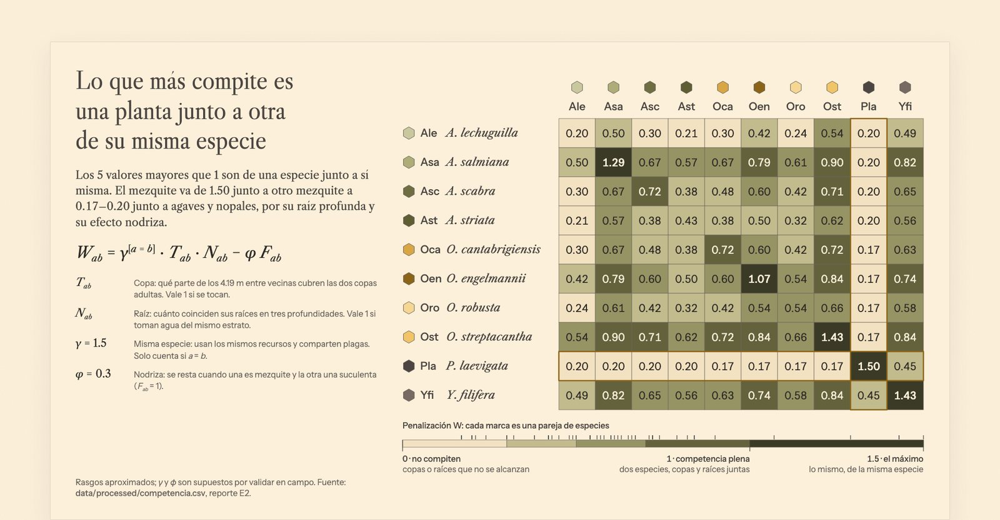</td>
<td width="50%">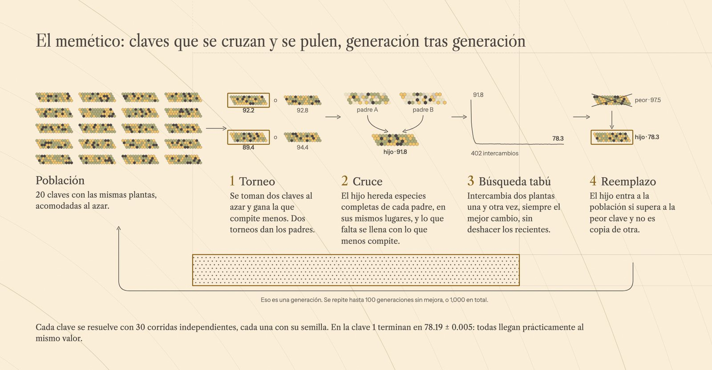</td>
</tr>
<tr>
<td valign="top"><b>Matriz de competencia <i>W</i>.</b> Combina el traslape de copas adultas, el de raíces por profundidad (índice de Pianka) y el efecto nodriza del mezquite. Valores de 0.17 a 1.50; lo que más compite es una especie grande junto a otra igual.</td>
<td valign="top"><b>Algoritmo memético.</b> 20 claves cruzadas por torneo; cada hijo se pule con <b>búsqueda tabú</b> sobre intercambios que conservan la composición. 30 corridas independientes por mosaico, en paralelo.</td>
</tr>
</table>

Hay del orden de $3.8\times10^{41}$ claves distintas con la misma composición, así que el memético no puede garantizar
el óptimo. Para medir qué tan lejos queda, `asignacion_exacta/` resuelve el **modelo entero** con HiGHS:

$$
\begin{aligned}
\min\quad & \sum_{(u,v)\in\mathcal{E}}\;\sum_{a,b\in\mathcal{S}} W_{ab}\,z_{uvab}\\
\text{s.a.}\quad & \textstyle\sum_{s} y_{vs}=1 \quad \forall v, \qquad \sum_{v} y_{vs}=m_s \quad \forall s,\\
& \textstyle\sum_{b} z_{uvab}=y_{ua}, \qquad \sum_{a} z_{uvab}=y_{vb}, \qquad y\in\{0,1\},
\end{aligned}
$$

donde las dos últimas restricciones linealizan $z_{uvab}=y_{ua}\,y_{vb}$. Se fija la especie más abundante en una
posición para romper la simetría por traslación, y el solver **arranca desde la mejor clave del memético**, así que
nunca reporta algo peor. Su cota inferior acota la brecha.

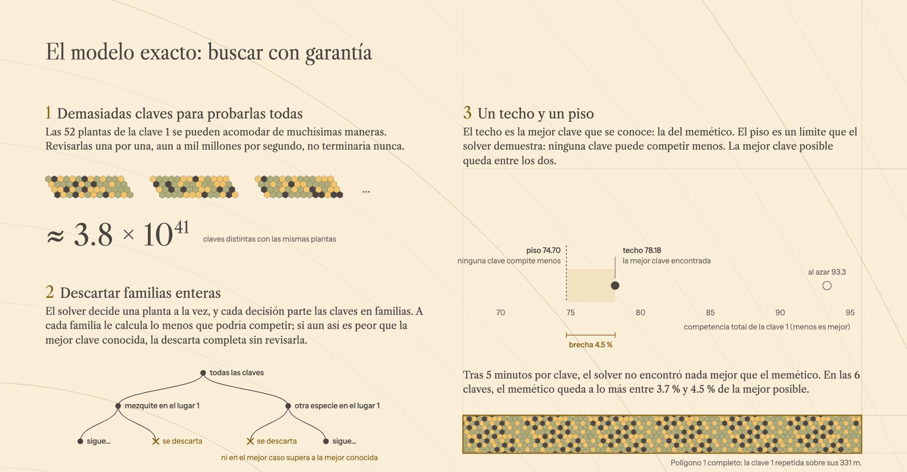

---

## ◆ Resultados

### Compra

<table>
<tr>
<td width="50%">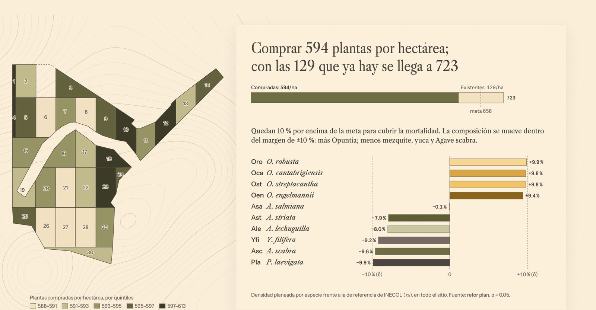</td>
<td width="50%">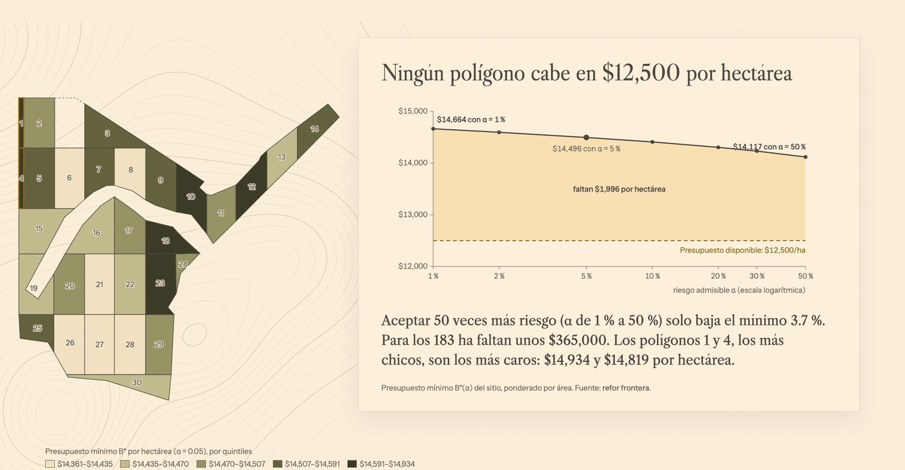</td>
</tr>
</table>

- **Sin restricción de presupuesto, la compra suma 108,680 plantas y \$2.65 millones** (594 plantas/ha). Con las 129/ha
  existentes, la densidad al plantar es de 723/ha, **10 % sobre la meta**: es la sobreplantación que absorbe la
  mortalidad del primer año con la confiabilidad exigida. La reposición esperada cuesta apenas \$5/ha.
- **La composición se mueve hacia el menor costo por planta sobreviviente** $c_s/q_s$: las cuatro *Opuntia* suben
  ~10 %; mezquite, yuca y *A. scabra* bajan ~10 %.
- **Los polígonos chicos son los más caros por hectárea** (\$14,934 en el polígono 1, de 1.28 ha): el margen de
  seguridad crece más lento que la meta y pesa más cuando ésta es pequeña.

**Presupuesto mínimo $B^*(\alpha)$**, ponderado por superficie (`refor frontera`):

| α (riesgo admisible) | 0.01 | 0.02 | 0.05 | 0.10 | 0.20 | 0.30 | 0.50 |
|---|---:|---:|---:|---:|---:|---:|---:|
| **$B^*$ (\$/ha)** | 14,664 | 14,596 | **14,496** | 14,408 | 14,305 | 14,233 | 14,117 |
| Faltante sobre \$12,500 (todo el sitio) | \$396 mil | \$384 mil | **\$365 mil** | \$349 mil | \$330 mil | \$317 mil | \$296 mil |

### Distribución espacial

Al redondear cada composición a 52 posiciones, **los 30 polígonos se reducen a seis claves de plantación**.

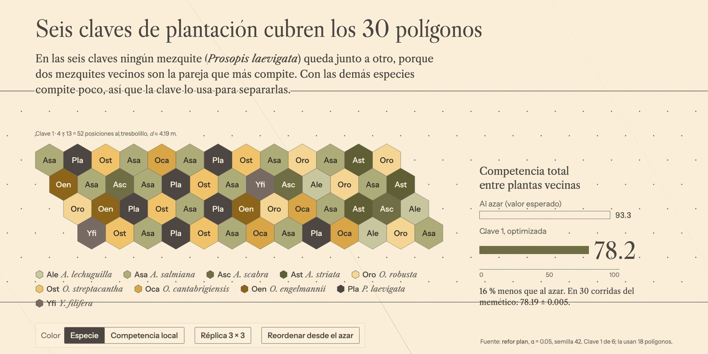

| Clave | Polígonos | Al azar (esperada) | Memético: mejor (media ± d.e., 30 corridas) | Cota inferior del exacto | Brecha máxima |
|:---:|:---:|---:|---:|---:|---:|
| 1 | 18 | 93.34 | **78.18** (78.19 ± 0.005) | 74.70 | 4.5 % |
| 2 | 5 | 92.37 | **77.37** (77.39 ± 0.006) | 74.27 | 4.0 % |
| 3 | 1 | 95.09 | **81.29** (81.29 ± 0.000) | 78.25 | 3.7 % |
| 4 | 1 | 91.74 | **76.77** (76.78 ± 0.005) | 73.55 | 4.2 % |
| 5 | 4 | 91.73 | **76.80** (76.80 ± 0.005) | 73.71 | 4.0 % |
| 6 | 1 | 95.90 | **81.85** (81.85 ± 0.000) | 78.82 | 3.7 % |

<sub>Modelo entero con HiGHS, 300 s por clave (`refor plan --exacto`). En ninguna clave encontró una solución mejor que la del memético.</sub>

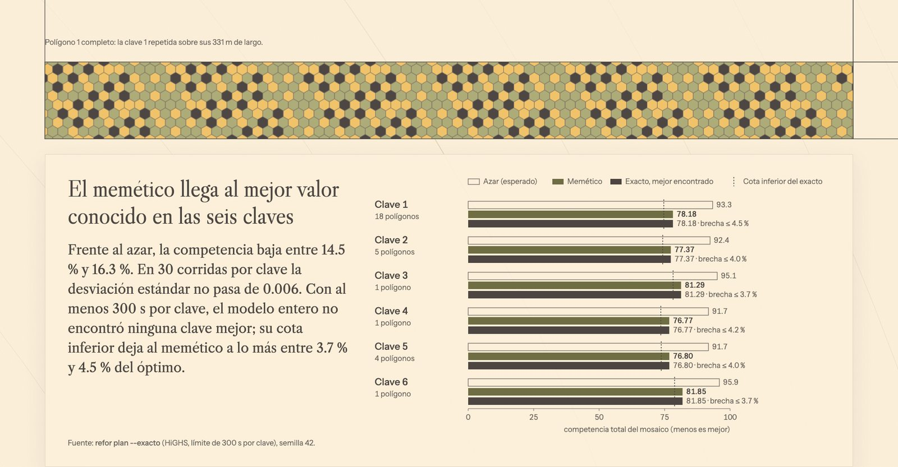

- **La competencia baja entre 14.5 % y 16.3 %** respecto a una siembra al azar con la misma composición.
- **El memético es muy estable:** la desviación estándar de 30 corridas no pasa de 0.006, y la mejora se detiene en
  promedio antes de la generación 25.
- **Ningún mezquite queda junto a otro.** *P. laevigata* tiene la mayor penalización intraespecífica (1.50) y la menor
  con las demás, así que la clave lo usa como separador entre las especies abundantes.

---

## ◆ Herramientas

El proyecto se usa de cuatro formas, todas sobre el mismo núcleo en C++:

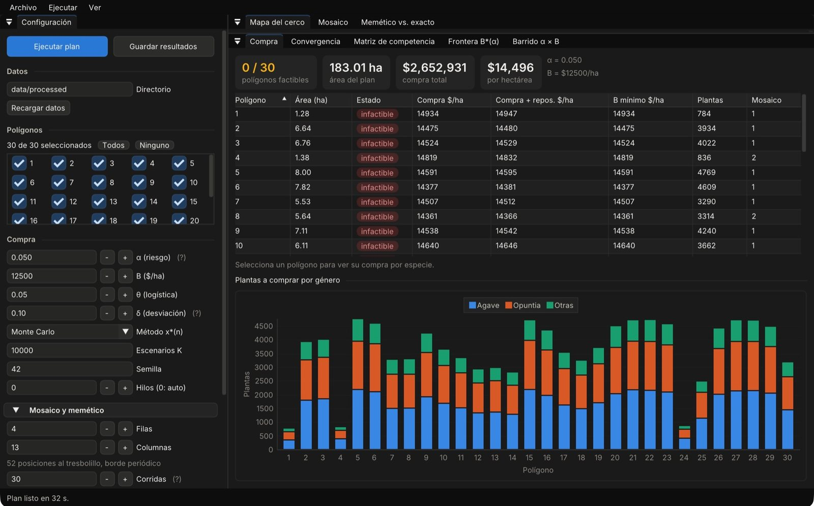

| | Qué es | Para quién |
|---|---|---|
| **`refor_gui`** | App de escritorio (Dear ImGui + ImPlot). Configura α, B y el memético; ejecuta en segundo plano con avance y cancelación; explora mosaico, compra, convergencia, memético vs. exacto, matriz *W*, frontera $B^*(\alpha)$ y barrido α × B; exporta txt, csv y json. | Técnicos de planeación de CONAFOR |
| **`refor`** (CLI) | Subcomandos `compra`, `frontera`, `barrido` y `plan`, con salida en tabla, CSV o JSON. | Análisis y reportes |
| **`refor_ple`** | El modelo entero de asignación espacial por sí solo. | Validación |
| **Visor y deck** (`docs/visor/`, `docs/presentacion/`) | Páginas HTML estáticas que leen la salida de `refor`: un visor con el mapa navegable y la presentación ejecutiva «Carta de campo». | Presentaciones |

---

## ◆ Descargar

En [**Releases**](https://github.com/Lunaaaalj/Stochastic_RefInit/releases) hay un paquete listo para cada sistema. No
hay que instalar nada y ya trae los datos de INECOL de los 30 polígonos.

| Sistema | Paquete | Cómo se abre |
|---|---|---|
| **Windows** 10/11 (x64) | `refor-<versión>-windows-x64.zip` | Descomprimir y doble clic en `refor_gui.exe` |
| **macOS** 13.3+ (Apple Silicon e Intel) | `refor-<versión>-macos-universal.zip` | Clic derecho en `Refor.app` → «Abrir» la primera vez (la app no está firmada) |
| **Linux** x64 (glibc 2.35+) | `refor-<versión>-linux-x64.tar.gz` | `tar xzf …` y `./refor_gui` |

Cada paquete incluye la app de escritorio, la CLI (`refor`, `refor_ple`), los datos en `datos/` y un `LEEME.md`.
**Para usar datos propios**, arrastra a la ventana una carpeta con los mismos CSV (o pasa `--datos` en la CLI). El
`LEEME` describe las columnas, y «Datos incluidos» vuelve a los de INECOL.

---

## ◆ Instalación y uso

**Requisitos:** CMake ≥ 3.24 y un compilador C++20 (clang ≥ 17, gcc ≥ 13). HiGHS y GLFW se toman del sistema o se
descargan solos; CLI11, Catch2, Dear ImGui e ImPlot siempre se descargan.

```bash
brew install highs glfw            # opcional (apt install libhighs-dev libglfw3-dev); acelera la primera compilación

cmake -S . -B build -DCMAKE_BUILD_TYPE=Release   # -DREFOR_GUI=OFF o -DREFOR_TESTS=OFF para omitirlos
cmake --build build -j
ctest --test-dir build                            # pruebas (Catch2)
```

Todo se corre **desde la raíz del repositorio**: los binarios leen `data/processed/` y escriben en `docs/res/`.

```bash
# Compra por polígono y especie para un (α, B)
./build/refor compra --alpha 0.05 -B 12500

# Presupuesto mínimo factible B*(α), por polígono y agregado
./build/refor frontera --alphas 0.01,0.05,0.10,0.20,0.50 -f csv

# Factibilidad en la rejilla α × B
./build/refor barrido --alphas 0.05,0.20 --B-min 13000 --B-max 16000 --B-paso 250 -f csv

# Plan completo: compra → composición → memético; con --exacto, también el modelo entero
./build/refor plan --alpha 0.05 -B 12500 -f json
./build/refor plan --alpha 0.05 -B 12500 --exacto --limite-exacto 300 -f json

# Interfaz gráfica
./build/refor_gui
```

<details>
<summary><b>Opciones principales</b></summary>

| Opción | Qué controla | Por defecto |
|---|---|---|
| `--alpha`, `-B` | Riesgo admisible y presupuesto por hectárea | — |
| `--theta` | Sobrecosto logístico | 0.05 |
| `--delta` | Desviación máxima por especie respecto al plan | 0.10 |
| `-K` | Escenarios Monte Carlo | 10,000 |
| `--metodo` | `mc` (Monte Carlo) o `exacto` (cola binomial) | `mc` |
| `--semilla`, `--hilos` | Semilla y número de hilos | 42, automático |
| `--filas`, `--columnas` | Tamaño del mosaico | 4 × 13 |
| `--corridas`, `--poblacion`, `--generaciones` | Memético | 30, 20, 1,000 |
| `--limite-exacto`, `--brecha-exacto` | Modelo entero: segundos por mosaico y brecha relativa | 300, 0 |
| `-f`, `-o`, `--dir` | Formato (`tabla`, `csv`, `json`) y destino | `tabla`, `docs/res/` |

La referencia completa de la CLI y del modelo implementado está en [`src/README.md`](src/README.md).

</details>

<details>
<summary><b>Ver los resultados en el navegador</b></summary>

```bash
python3 -m http.server 8000        # desde la raíz del repo
```

- Visor de resultados: <http://localhost:8000/docs/visor/> (ver [`docs/visor/README.md`](docs/visor/README.md))
- Presentación ejecutiva: <http://localhost:8000/docs/presentacion/>

</details>

<details>
<summary><b>Regenerar los datos</b></summary>

```bash
# CSV de entrada desde los Excel de INECOL (data/raw/ nunca se edita)
uv run --no-project --with pandas --with openpyxl python scripts/exportar_datos.py

# Datos del deck (requiere antes `refor frontera … -f csv` y `refor plan --exacto -f json`)
python3 scripts/datos_presentacion.py
```

</details>

### Reproducibilidad

**Con la misma `--semilla`, el resultado es idéntico sin importar el número de hilos ni la plataforma.** Cada flujo
aleatorio se siembra con su identidad lógica —`semilla_derivada(semilla, polígono, especie)`, y para el memético el
mosaico y el número de corrida—, nunca con el orden de ejecución. El memético usa un entero uniforme y un barajado
propios (`src/azar.hpp`) en lugar de `std::uniform_int_distribution` y `std::shuffle`, cuyos algoritmos cambian entre
libc++ y libstdc++, y la aritmética se compila sin FMA implícito (`-ffp-contract=off`). El workflow de release comprueba
en cada versión que Windows, macOS y Linux den archivos idénticos.

---

## ◆ Arquitectura

Tres ejecutables comparten la biblioteca estática `refor_core` (todo `src/` salvo `main.cpp`), en el espacio de nombres `refor`.

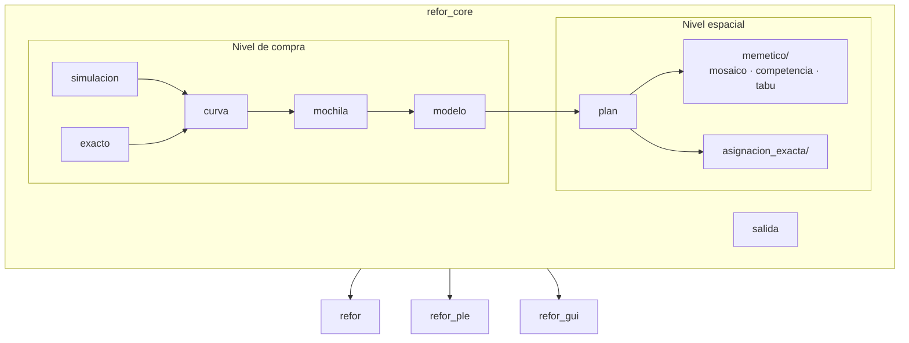

```text
.
├── src/                    refor_core y la CLI (ver src/README.md)
│   ├── simulacion, curva, exacto, mochila, modelo   nivel de compra
│   ├── plan, memetico/, asignacion_exacta/          nivel espacial
│   └── salida, main.cpp                             salida y subcomandos
├── gui/                    refor_gui: una vista por pestaña, trabajos en segundo plano
├── tests/                  pruebas Catch2: datos, simulacion, exacto, mochila, modelo, memetico, plan, ple
├── data/
│   ├── raw/                Excel de INECOL (inmutables)
│   └── processed/          especies, poligonos, existentes, competencia, mapa (.csv)
├── scripts/                exportar_datos, digitalizar_mapa, datos_presentacion
├── reports/                reportes LaTeX de las entregas E1 y E2
└── docs/
    ├── presentacion/       deck ejecutivo HTML (identidad en DESIGN.md)
    ├── visor/              visor de resultados HTML
    └── res/                salida de refor (ignorada por git)
```

---

## ◆ Documentos

| | |
|---|---|
| [`reports/e1/main.pdf`](reports/e1/main.pdf) | **E1:** definición del problema, incertidumbre y revisión de literatura |
| [`reports/e2/main.pdf`](reports/e2/main.pdf) | **E2:** modelo de compra, modelo espacial y resultados |
| [`src/README.md`](src/README.md) | Referencia de la CLI, la GUI y el modelo implementado |
| [`PRODUCT.md`](PRODUCT.md) | Usuarios, propósito y principios del producto |
| [`docs/presentacion/DESIGN.md`](docs/presentacion/DESIGN.md) | Identidad visual «Carta de campo» (también rige `refor_gui`) |
| [`CONTRIBUTING.md`](CONTRIBUTING.md) | Flujo de trabajo del equipo: ramas, commits y PR |

---

<div align="center">

**Angel Eduardo-Luna · Irasema Alvarez · Carolina Sánchez Meneses · Andrea Estefania de la Peña**

Tecnológico de Monterrey · MA2004B, grupo 202, equipo 5<br>
Socio formador: **CONAFOR** · Datos: **INECOL**

<sub>Octubre de 2026</sub>

</div>
